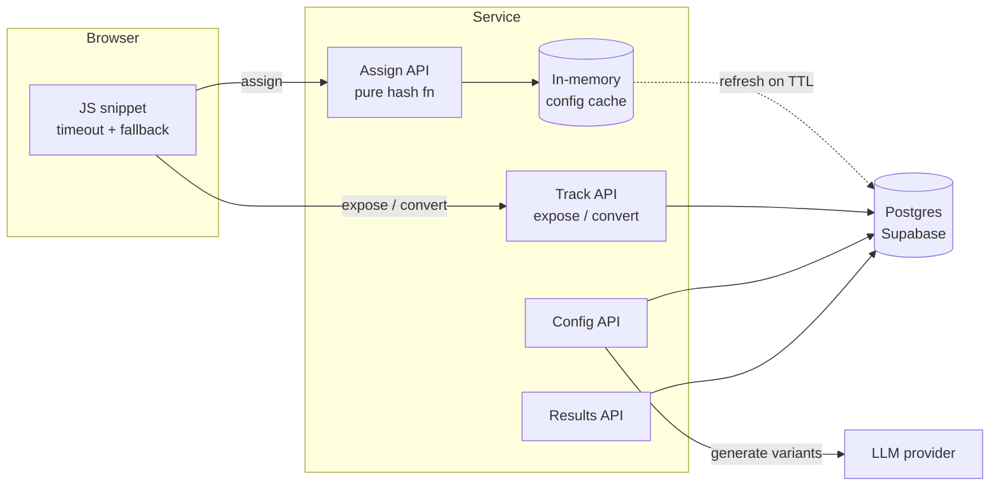

# Design Document: Experiment Assignment Service

> One-line summary: a stateless, deterministic assignment API on the page-render path, with durable idempotent event tracking and LLM content generated off the hot path.

_Writing note: keep this in first person with clear stances ("I chose X; I'd revisit it when Y"). Replace every `TODO` with real numbers from your tests._

---

## 1. Goals and Non-Goals

**Goals**
- Answer "which variant does this visitor see?" fast, deterministically, and never break the page
- Record exposures and conversions durably and idempotently
- Report per-variant results with basic statistical validity checks
- Support LLM-generated variant content without putting the LLM on the critical path

**Targets (latency budget)**
- `/assign` server-side: p50 < 5ms, p99 < 20ms (warm cache) — measured: `TODO`
- Client snippet hard timeout: 150–200ms, then fall back to control
- Tracking calls: fire-and-forget from the client (`sendBeacon`), never block render

**Non-goals (for this submission)**
- Multi-tenant auth and billing, a config UI, bandit allocation, cross-site learning (see §11)

---

## 2. Architecture

Three paths with very different requirements:

| Path | Frequency | Latency sensitivity | Can fail? |
|---|---|---|---|
| **Configure** (create experiment, LLM generation) | Rare | Low | Yes, user retries |
| **Run** (assign + track) | Every page view | Critical | Must degrade to control |
| **Measure** (results) | Occasional | Low | Yes |

**Components**
- **JS snippet**: generates/stores visitor ID, calls `/assign` with a hard timeout, falls back to control, sends exposure on render
- **Assignment API**: pure function of (visitor_id, experiment config); no DB read on the hot path when the cache is warm
- **Tracking API**: `/expose`, `/convert`; idempotent writes
- **Config API**: create experiments, status transitions (draft → running → paused → stopped), triggers LLM generation. Variants/weights immutable once running- **Results API / page**: aggregates + stats
- **Storage**: Postgres (Supabase) via the transaction-mode connection pooler

**Key decisions**
| Decision | Why | Alternative considered | Revisit when |
|---|---|---|---|
| Hash-based assignment, no stored assignments | Deterministic, zero storage, nothing to fail | Store assignment per visitor | Need per-visitor overrides / forced variants |
| Config cached in memory with TTL | Removes DB from hot path | Redis | Many instances / need faster propagation |
| Postgres for events | Unique constraints = idempotency; simple SQL aggregation | Event stream + OLAP | Write volume exceeds single primary (§5) |
| LLM at config time | Latency, cost, failure isolation | Per-request generation | Never on the hot path |
| Serverless (Vercel) | Fast to ship | Long-running service / edge | Cold starts or cache misses hurt p99 |

---

## 3. Determinism and Distribution

- Two independent hashes per visitor, both `sha256(...)` → first 8 bytes → `mod 10000` (never Python's process-salted `hash()`):
  - `enroll = bucket(salt, "enroll", visitor_id)` — enrolled if `< traffic × 100`, else not enrolled → served default
  - `variant = bucket(salt, "variant", visitor_id)` — mapped onto cumulative weight ranges, e.g. 90/10 → `[0, 9000)` A, `[9000, 10000)` B
- **Why two hashes:** raising traffic % (e.g. 20 → 50) enrols new visitors without moving already-enrolled visitors to a different variant
- **Sticky:** pure function of inputs; identical across calls, instances, restarts. Nothing is stored
- **Well distributed:** sha256 output is uniform; 10,000 buckets gives 0.01% allocation granularity
- **Experiments independent:** each experiment has its own salt, so assignments are uncorrelated across experiments
- **Variant order is part of the contract:** ranges follow a fixed stored order (`position`); reordering would reshuffle visitors
- **Allocation changes mid-experiment:** would reshuffle visitors and bias results → variants and weights are immutable once running; a change means a new experiment (new salt)
- **Evidence** (100k seeded visitors, `pytest -s`):
  - 50/50 → 49.87% / 50.13%; 90/10 → 90.05% / 9.95%
  - Holdback traffic=20 → 19.99% enrolled
  - Independence: joint cells 24.81–25.17% (target 25%),

## 4. API Overview

| Method | Path | Purpose |
|---|---|---|
| POST | `/experiments` | Create experiment (variants, allocation, optional LLM generation) |
| GET | `/experiments/{id}` | Read config |
| PATCH | `/experiments/{id}/status` | Draft → running → paused → stopped (kill switch) |
| POST | `/assign` | Visitor + experiment IDs → variants (+ payload) |
| POST | `/expose` | Record exposure (idempotent) |
| POST | `/convert` | Record conversion (idempotent) |
| GET | `/results/{id}` | Per-variant exposures, conversions, rate, stats |

_Auth: admin API key for config/results; assign/track are public, scoped by a site key (see §7)._

---

## 5. Scale

**Back-of-envelope (example: 10k page views/sec across all sites)** — `TODO: adjust to your numbers`
- Assign calls: 10k/s → pure CPU; one small instance handles thousands/s, scale horizontally
- Exposure writes: up to 10k/s (deduped, but each is still a request + insert attempt)
- Conversion writes: ~2–5% of exposures → 200–500/s
- Raw event storage: ~100 bytes/row × 10k/s × 86,400 ≈ ~85 GB/day → raw events can't live in the primary DB forever
- Cost: assignment is near-free; cost is dominated by event ingestion and storage

**Read path (assignment)** — stateless, CPU-only, horizontally scalable, can move to edge. Bottleneck is config freshness, not compute.

**Write path (tracking)** — the real bottleneck.
- Now: direct inserts with `ON CONFLICT DO NOTHING`
- At scale: snippet batches events → thin ingestion endpoint → queue (Kafka/Kinesis) → batched consumers → pre-aggregated counters per (experiment, variant, hour) + raw events to object storage / OLAP

**What breaks first at 100×**
1. **DB write throughput and connection count** — fix: queue + batched writes; pooler; stop writing raw rows synchronously
2. **Results query cost** (`GROUP BY` over billions of rows) — fix: incremental pre-aggregation; results read counters, not raw events
3. **Config propagation** across many instances — fix: push config to edge KV / pub-sub invalidation instead of TTL polling
4. **Serverless cold starts** hurting p99 — fix: long-running instances or edge runtime

**What to cache**: experiment config (in-process, edge), results (short TTL), never assignments (computed, not looked up).

---

## 6. Reliability and Failure Modes

**Principle:** the customer's page must render whatever happens to us. Default = control/original content.

| Failure | Behaviour |
|---|---|
| Service slow/unreachable | Snippet timeout → render control, no exposure logged |
| DB unavailable on assign | Serve last-known cached config; if none, return control |
| DB unavailable on tracking | Return fast; drop or buffer events (prefer small data loss over blocking the page) |
| Unknown / paused experiment | Return control |
| LLM failure at config time | Variant falls back to static copy; experiment still created |
| Bad config pushed | Validation on write (weights sum to 100, ≥ 2 variants, unique keys, traffic 0–100) |
| Cold start (serverless) | Slower first request; snippet timeout still protects the page |

- Snippet loads async and never blocks render; flicker trade-off (anti-flicker hide with a hard cap) noted
- **Kill switch:** pause → control for everyone on next config refresh

**Config propagation lag** — after a pause or edit, each instance may serve the old config for up to the cache TTL (`TODO`s). I accept this because (a) it's bounded, (b) shortening it pushes load to the DB. For a true emergency stop at scale: pub/sub invalidation.

---

## 7. Edge Cases

- **Visitor identity:** the snippet generates a random UUID and stores it in a first-party cookie/localStorage. Cookie clearing or a new device = new visitor → may see a different variant. Logged-in sites can pass their own user ID for cross-device consistency.
- **Out-of-order events:** a conversion may arrive before its exposure (network, retries). Store conversions independently; results join at query time, so late exposures are counted correctly. Conversions with no exposure are excluded from rates.
- **Overlapping experiments:** two experiments changing the same element interfere. Support mutually exclusive groups ("layers"): hash into a layer first, then into an experiment. Documented; `TODO: built or next step`.
- **Abuse / fake events:** assign and track are public. Mitigations: site-scoped keys, origin checks, rate limiting per visitor/IP, rejecting events for experiments that aren't running. At scale: signed assignment tokens so a conversion must reference a real assignment.
- **Bots:** inflate exposures and dilute rates → user-agent filtering now, behavioural filtering later.
- **Privacy:** store only a random visitor ID, no PII. Event retention policy (`TODO`, e.g. 90 days raw, aggregates kept). Respect consent: if the site hasn't got consent, the snippet serves control and doesn't track.

---

## 8. Correctness and Statistical Validity

**Counting**
- Exposure unique on `(experiment_id, visitor_id)` → duplicates ignored
- Conversion unique on `(experiment_id, visitor_id)`, counted only if exposed
- Exposure logged on actual render, not on assignment (visitors who never saw the variant aren't counted)

**Statistics reported**
- Conversion rate with 95% confidence interval per variant
- Two-proportion z-test vs control
- **Sample Ratio Mismatch (SRM):** chi-square of observed vs expected split; a significant mismatch flags broken assignment or tracking, so results are marked untrustworthy

**Known pitfalls (documented, not all solved)**
- Peeking / repeated significance testing → fixed horizon or sequential testing next
- Multiple variants → multiple-comparison correction
- Novelty effects, cookie churn, bots

---

## 9. The LLM Decision

- **Placement:** at experiment creation/edit time, in the config API. Generated content stored as the variant payload
- **Never on the assignment path:** LLM latency (seconds), cost per call, and failure rate are incompatible with a page-render path
- **Cost:** one call per experiment (N variants), not per page view — `TODO: approx cost per generation`
- **Latency:** synchronous in the admin request with a timeout (serverless can't run post-response background work); async job queue at scale
- **Failure:** timeout/error → fallback static copy; experiment still usable
- **Safety:** generated copy has a review status; only approved variants go live. Keys server-side only
- **Future:** per-segment generation; generating new challengers from winning variants

---

## 10. Testing

- Unit: hashing determinism, allocation boundaries (bucket 0, 8999, 9000, 9999), invalid configs
- Simulation: distribution and independence across 100k visitors
- Integration: duplicate exposures/conversions ignored; conversion-before-exposure handled
- Failure: DB down → assign still returns from cache / control
- `TODO: load test numbers (requests/sec, p50/p99)`

---

## 11. Trade-offs and Next Steps

**Deliberately not built**
- `TODO: config UI, multi-tenant auth, event queue, bandits, bot filtering, layers, ...`

**With more time**
- Batched event ingestion via queue; pre-aggregated counters
- Edge-deployed assignment with config pushed to edge KV
- Sequential testing to allow safe peeking

**Extensions**
- **Smarter allocation:** Thompson sampling / multi-armed bandits shifting traffic to winners (trade-off: faster wins vs clean statistical inference)
- **Across many sites:** priors from past experiments, shared learnings on what patterns win, strict tenant privacy boundaries
- **Targeting/personalisation:** segment-based allocation rules evaluated inside the same pure function

---

## 12. How to Verify

- Live URL, demo page, results page: `TODO`
- Test commands: `TODO`
- Example `curl` calls: `TODO`
