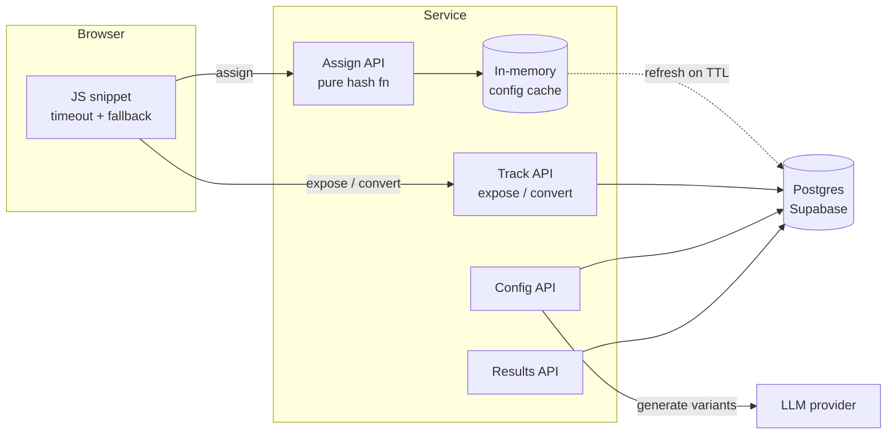

# Design Document: Experiment Assignment Service

> One-line summary: a stateless, deterministic assignment API on the page-render path, with durable idempotent event tracking and LLM content generated off the hot path.

---

## 1. Goals and Non-Goals

**Goals**
- Answer "which variant does this visitor see?" fast, deterministically, and never break the page
- Record exposures and conversions durably and idempotently
- Report per-variant results with basic statistical validity checks
- Support LLM-generated variant content without putting the LLM on the critical path

**Targets (latency budget)**
- `/assign` server-side: p50 < 5ms, p99 < 20ms (warm cache)
- Client snippet hard timeout: 200ms, then fall back to the page's default content
- Tracking calls: fire-and-forget from the client (`sendBeacon`), never block render

**Measured** (one run on 2026-10-30: 2,000 simulated visitors, concurrency 20, client in Bangalore, service in Dublin)

| Measure | p50 | p99 |
|---|---|---|
| `/assign` server-side (`Server-Timing`) | 0.06ms | 0.40ms |
| `/assign` round trip from the client | 165.1ms | 367.7ms |

The server-side target is met with plenty of room. The round trip is a different story: roughly 150ms of it is network between Bangalore and Dublin (an estimate, not a separate measurement), and 284 of 2,000 requests (14.2%) took longer than the snippet's 200ms timeout. Those visitors would see default content. Server-side time covers only the `/assign` handler, so it excludes cold starts, platform routing and the network. The simulator also reuses connections, so a first-time browser visitor would likely be slower. §5 covers what I take from this.

**Non-goals (for this submission)**
- Multi-tenant auth and billing, a config UI, bandit allocation, cross-site learning (see §11)

---

## 2. Architecture

Three paths with very different requirements:

| Path | Frequency | Latency sensitivity | Can fail? |
|---|---|---|---|
| **Configure** (create experiment, LLM generation) | Rare | Low | Yes, user retries |
| **Run** (assign + track) | Every page view | Critical | Must degrade to control |
| **Measure** (results) | Occasional | Low | Yes |



**Components**
- **JS snippet**: generates/stores visitor ID, calls `/assign` with a hard timeout, falls back to control, sends exposure on render
- **Assignment API**: pure function of (visitor_id, experiment config); no DB read on the hot path when the cache is warm
- **Tracking API**: `/expose`, `/convert`; idempotent writes
- **Config API**: create experiments, status transitions (draft → running → paused → stopped), triggers LLM generation. Variants/weights immutable once running
- **Results API / page**: aggregates + stats
- **Storage**: Postgres (Supabase) via the transaction-mode connection pooler

**Key decisions**
| Decision | Why | Alternative considered | Revisit when |
|---|---|---|---|
| Hash-based assignment, no stored assignments | Deterministic, zero storage, nothing to fail | Store assignment per visitor | Need per-visitor overrides / forced variants |
| Config cached in memory with TTL | Removes DB from hot path | Redis | Many instances / need faster propagation |
| Postgres for events | Unique constraints = idempotency; simple SQL aggregation | Event stream + OLAP | Write volume exceeds single primary (§5) |
| LLM at config time | Latency, cost, failure isolation | Per-request generation | Never on the hot path |
| Serverless (Vercel) | Fast to ship | Long-running service / edge | Cold starts or cache misses hurt p99 |

---

## 3. Determinism and Distribution

- Two independent hashes per visitor, both `sha256(...)` → first 8 bytes → `mod 10000` (never Python's process-salted `hash()`):
  - `enroll = bucket(salt, "enroll", visitor_id)` — enrolled if `< traffic × 100`, else not enrolled → served default
  - `variant = bucket(salt, "variant", visitor_id)` — mapped onto cumulative weight ranges, e.g. 90/10 → `[0, 9000)` A, `[9000, 10000)` B
- **Why two hashes:** raising traffic % (e.g. 20 → 50) enrols new visitors without moving already-enrolled visitors to a different variant
- **Sticky:** pure function of inputs; identical across calls, instances, restarts. Nothing is stored
- **Well distributed:** sha256 output is uniform; 10,000 buckets gives 0.01% allocation granularity
- **Experiments independent:** each experiment has its own salt, so assignments are uncorrelated across experiments
- **Variant order is part of the contract:** ranges follow a fixed stored order (`position`); reordering would reshuffle visitors
- **Allocation changes mid-experiment:** would reshuffle visitors and bias results → variants and weights are immutable once running; a change means a new experiment (new salt)
- **Evidence** (100k seeded visitors, `pytest -s`):
  - 50/50 → 49.87% / 50.13%; 90/10 → 90.05% / 9.95%
  - Holdback traffic=20 → 19.99% enrolled
  - Independence: joint cells 24.81–25.17% (target 25%), correlation 0.0004

---

## 4. API Overview

| Method | Path | Purpose |
|---|---|---|
| POST | `/experiments` | Create a draft experiment (variants, allocation) |
| GET | `/experiments/{id}` | Read config |
| PATCH | `/experiments/{id}/status` | Draft → running ↔ paused → stopped, also running → stopped (kill switch) |
| POST | `/experiments/{id}/variants/{key}/generate` | Generate LLM copy for a variant, draft only |
| POST | `/experiments/{id}/variants/{key}/approve` | Approve a variant's copy |
| POST | `/assign` | Visitor + experiment IDs → variants (+ payload) |
| POST | `/expose` | Record exposure (idempotent) |
| POST | `/convert` | Record conversion (idempotent) |
| GET | `/results/{id}` | Per-variant exposures, conversions, rate, stats |

_Auth: admin API key for config and results. Assign and track are public and accept JSON or `text/plain`, so the snippet avoids a CORS preflight inside its 200ms budget. Nothing scopes them to a site yet (see §7)._

---

## 5. Scale

**Back-of-envelope (example load, not a measurement: 10k page views/sec across all sites)**
- Assign calls: 10k/s → pure CPU; one small instance handles thousands/s, scale horizontally
- Exposure writes: up to 10k/s (deduped, but each is still a request + insert attempt)
- Conversion writes: ~2–5% of exposures → 200–500/s
- Raw event storage: ~100 bytes/row × 10k/s × 86,400 ≈ ~85 GB/day → raw events can't live in the primary DB forever
- Cost: assignment is near-free; cost is dominated by event ingestion and storage

**Read path (assignment)** — stateless, CPU-only, horizontally scalable, can move to edge. Bottleneck is config freshness, not compute.

**Write path (tracking)** — the real bottleneck.
- Now: direct inserts with `ON CONFLICT DO NOTHING`
- At scale: snippet batches events → thin ingestion endpoint → queue (Kafka/Kinesis) → batched consumers → pre-aggregated counters per (experiment, variant, hour) + raw events to object storage / OLAP

**What breaks first at 100×**
1. **DB write throughput and connection count** — fix: queue + batched writes; pooler; stop writing raw rows synchronously
2. **Results query cost** (`GROUP BY` over billions of rows) — fix: incremental pre-aggregation; results read counters, not raw events
3. **Config propagation** across many instances — fix: push config to edge KV / pub-sub invalidation instead of TTL polling
4. **Serverless cold starts** hurting p99 — fix: long-running instances or edge runtime

**Region is the real limit on assignment.** The measured server time is under a millisecond, but a single region leaves little of a 200ms budget for distant visitors. From Bangalore to Dublin, network alone takes roughly 150ms (estimate), and 14.2% of simulated requests missed the timeout (§1). Those visitors get default content, which is safe, but they also drop out of the experiment, so a distant audience is under-sampled. I'd fix this with edge or multi-region assignment, not by raising the timeout, because a longer timeout makes every visitor wait longer on a bad day. Assignment makes that move easy: it's pure and DB-free, so only the config cache has to reach each region. Tracking can stay in one region because `sendBeacon` doesn't block the page.

**What to cache**: experiment config (in-process, edge), results (short TTL), never assignments (computed, not looked up).

---

## 6. Reliability and Failure Modes

**Principle:** the customer's page must render whatever happens to us. Default = control/original content.

| Failure | Behaviour |
|---|---|
| Service slow/unreachable | 200ms snippet timeout → render default content, no exposure logged |
| DB unavailable on assign | Serve last-known cached config; if none, return nulls so the page shows default content. A failed refresh waits a full TTL before retrying, so an outage can't stall every request |
| DB unavailable on tracking | Drop the event and still return 202. I don't buffer: serverless can't work after responding, and I prefer small data loss to blocking the page. A connect is abandoned after 1s and a statement after 500ms, so a call takes about 1.5s at worst |
| Unknown / paused experiment | Return control |
| LLM failure at config time | Variant falls back to static copy; experiment still created |
| Bad config pushed | Validation on write (weights sum to 100, ≥ 2 variants, unique keys, traffic 0–100) |
| Cold start (serverless) | Slower first request; the snippet timeout still protects the page. A cold instance has an empty cache, and requests that arrive while its first load runs get nulls and serve default content |

- Snippet loads async and never blocks render; flicker trade-off (anti-flicker hide with a hard cap) noted
- **Kill switch:** pause → control for everyone on next config refresh

**Config propagation lag** — after a pause or edit, each instance may serve the old config for up to the cache TTL (30s by default, `CONFIG_TTL_SECONDS`), and for longer during a DB outage because it keeps its last-known config. I accept this because (a) it's bounded, (b) shortening it pushes load to the DB. For a true emergency stop at scale: pub/sub invalidation.

---

## 7. Edge Cases

- **Visitor identity:** the snippet generates a random UUID and stores it in a first-party cookie/localStorage. Cookie clearing or a new device = new visitor → may see a different variant. Logged-in sites can pass their own user ID for cross-device consistency.
- **Out-of-order events:** a conversion may arrive before its exposure (network, retries). Store conversions independently; results join at query time, so late exposures are counted correctly. Conversions with no exposure are excluded from rates.
- **Overlapping experiments:** two experiments changing the same element interfere. Support mutually exclusive groups ("layers"): hash into a layer first, then into an experiment. Not built; it's the next step for anyone running overlapping tests.
- **Tracking trusts no client variant:** `/expose` and `/convert` take only the experiment and visitor IDs. The server recomputes the variant with `assign()` from cached config and ignores events for unknown, non-running or non-enrolled cases. A client can't pick a variant or fill the tables with junk experiment IDs.
- **Known gap, late conversions:** a visitor exposed just before a pause or stop who converts afterwards is dropped, because the experiment is no longer running. I accept this for short conversion windows. For long ones I'd allow a grace period after the experiment ends.
- **Known gap, empty config:** an instance with no config can't recompute a variant, so it drops the event and still returns 202. That's safe for `/assign` but is silent data loss here. In the measured run, 8 of 1,991 exposures (0.4%) sent were not stored. I can't say this was the cause without the logs; the 1s connect limit could also explain it.
- **Known gap, fake visitors:** recomputing stops a client choosing a variant, but anyone can still send events for made-up visitor IDs, which inflates counts and could trigger a false SRM. Site-scoped keys, origin checks and rate limiting are the first fixes, none of them built. At scale: signed assignment tokens, so a conversion must reference a real assignment.
- **Bots:** inflate exposures and dilute rates. Not filtered yet; I'd start with user-agent filtering, then behavioural filtering.
- **Privacy:** store only a random visitor ID, no PII. There's no retention job yet; I'd keep raw events for about 90 days and keep aggregates. Consent is the host page's call: without consent it shouldn't call `variants.run`, which leaves default content and sends nothing.

---

## 8. Correctness and Statistical Validity

**Counting**
- Exposure unique on `(experiment_id, visitor_id)` → duplicates ignored
- Conversion unique on `(experiment_id, visitor_id, goal)`, counted only if exposed, so one visitor can convert once per goal
- Both tables store the server-computed `variant_key`; results count conversions through the exposure join
- Exposure logged on actual render, not on assignment (visitors who never saw the variant aren't counted)

**Statistics reported**
- Conversion rate with 95% confidence interval per variant
- Two-proportion z-test vs control
- **Sample Ratio Mismatch (SRM):** chi-square of observed vs expected split; a significant mismatch flags broken assignment or tracking, so results are marked untrustworthy

**Known pitfalls (documented, not all solved)**
- Peeking / repeated significance testing → fixed horizon or sequential testing next
- Multiple variants → multiple-comparison correction
- Novelty effects, cookie churn, bots

---

## 9. The LLM Decision

- **Placement:** at configure time, through an admin endpoint that only works while the experiment is a draft. Generated copy is stored in the variant payload
- **Never on the assignment path:** LLM latency (seconds), cost per call, and failure rate are incompatible with a page-render path
- **Cost:** per experiment, not per page view: one call per generated field per variant, and nothing at assign time. This is an estimate. At Haiku 5.5 pricing of $0.10/MTok input and $0.50/MTok output, and assuming about 250 input and 250 output tokens per generation (thinking included), one call costs about $0.00015, so a two-variant experiment with one generated field each costs about $0.0003. I haven't measured the token counts: each generation stores its real usage in `generation_meta`, which is where to replace this assumption
- **Latency:** synchronous in the admin request with a timeout (serverless can't run post-response background work); async job queue at scale
- **Failure:** 10s timeout and no retries. Timeout, API error or bad JSON → 502, and the variant keeps its static copy, so the experiment stays usable
- **Safety:** generated copy starts unapproved, and draft → running is blocked until every variant is approved. That check shares a row lock with saving copy, so unapproved copy can't slip in during a start. Keys stay server-side, and upstream error text is never logged or returned
- **Future:** per-segment generation; generating new challengers from winning variants

---

## 10. Testing

217 automated tests, run with `pytest`. Tests start their own embedded Postgres, because idempotency and the results join live in the SQL, and they never call the real LLM API.

- Unit: hashing determinism, allocation boundaries (bucket 0, 8999, 9000, 9999), invalid configs, statistics against reference values computed with scipy and statsmodels
- Simulation: distribution and independence across 100k visitors
- Integration: duplicate exposures/conversions ignored; conversion-before-exposure handled; conversions without an exposure excluded; status transitions and the approval gate
- Failure: DB down → assign still returns from cache / control, tracking still returns 202; LLM timeout, error and bad JSON leave copy untouched
- Browser: I ran the snippet, demo and dashboard in real Chrome against a local server during development (35 checks, including slow and failing `/assign`, blocked storage and a cross-origin page, with zero `OPTIONS` requests). Those checks aren't in the repo, so they don't run with `pytest`

**Live run** (`scripts/simulate.py`, 2,000 visitors, concurrency 20, Bangalore to Dublin, 2026-10-30)

| Measure | Result |
|---|---|
| Server-side `/assign` p50 / p99 | 0.06ms / 0.40ms |
| Round-trip `/assign` p50 / p99 | 165.1ms / 367.7ms |
| Round trips over 200ms | 284 of 2,000 (14.2%) |
| Observed split | A 50.38% / B 49.62% |
| Not assigned | 9 of 2,000 |
| Exposures sent → stored | 1,991 → 1,983 (8 missing, 0.4%) |
| Conversions sent → stored | 114 → 114 |
| Failed requests | 0 |

Network caveat: about 150ms of each round trip is an estimate of Bangalore-to-Dublin network time, so the round-trip numbers describe this client, not the service. An earlier run from the same machine gave p50 160ms, p99 594ms, 75 requests over 200ms and 21 not assigned, so tail latency varies a lot between runs. These are single runs, not a sustained load test, and I have no requests/sec capacity figure.

---

## 11. Trade-offs and Next Steps

**Deliberately not built**
- **Config UI:** the API and a small results page are enough to run experiments
- **Multi-tenant auth:** one admin key, and no site-scoped keys on public endpoints
- **Abuse controls:** no rate limiting, origin checks or signed assignment tokens, so fake events are an open gap (§7)
- **Event queue or buffering:** tracking writes directly and drops on failure
- **Bandits:** fixed allocation keeps the statistics simple
- **Bot filtering:** bots count as visitors today
- **Layers:** no mutual exclusion between overlapping experiments
- **Retention job:** raw events are kept indefinitely for now
- **Statistical guardrails:** no sequential testing or multiple-comparison correction, so peeking and many-variant tests can overstate significance
- **Multi-region assignment:** one region (Dublin), despite the latency cost in §5

**With more time**
- Batched event ingestion via queue; pre-aggregated counters
- Edge-deployed assignment with config pushed to edge KV
- Sequential testing to allow safe peeking

**Extensions**
- **Smarter allocation:** Thompson sampling / multi-armed bandits shifting traffic to winners (trade-off: faster wins vs clean statistical inference)
- **Across many sites:** priors from past experiments, shared learnings on what patterns win, strict tenant privacy boundaries
- **Targeting/personalisation:** segment-based allocation rules evaluated inside the same pure function

---

## 12. How to Verify

**Live URLs**
- Service: https://variant-service.vercel.app
- Demo page: https://variant-service.vercel.app/demo
- Results page: https://variant-service.vercel.app/dashboard (needs the admin key, shared separately)

**Test commands**

```sh
.venv/bin/pip install -r requirements-dev.txt
.venv/bin/pytest -s
.venv/bin/python scripts/simulate.py --base-url https://variant-service.vercel.app \
  --experiment cta-test --rates A=0.05,B=0.07
```

**Example `curl` calls** (the [README](README.md) has the full create → generate → approve → start → assign → expose → convert → results walkthrough)

```sh
BASE=https://variant-service.vercel.app

curl -i -X POST $BASE/assign -H 'Content-Type: text/plain' \
  -d '{"visitor_id": "visitor-1", "experiment_ids": ["cta-test"]}'

curl -X POST $BASE/expose -H 'Content-Type: text/plain' \
  -d '{"experiment_id": "cta-test", "visitor_id": "visitor-1"}'

curl -X POST $BASE/convert -H 'Content-Type: text/plain' \
  -d '{"experiment_id": "cta-test", "visitor_id": "visitor-1", "goal": "default"}'

curl $BASE/results/cta-test -H "X-Admin-Key: $ADMIN_KEY"
```
